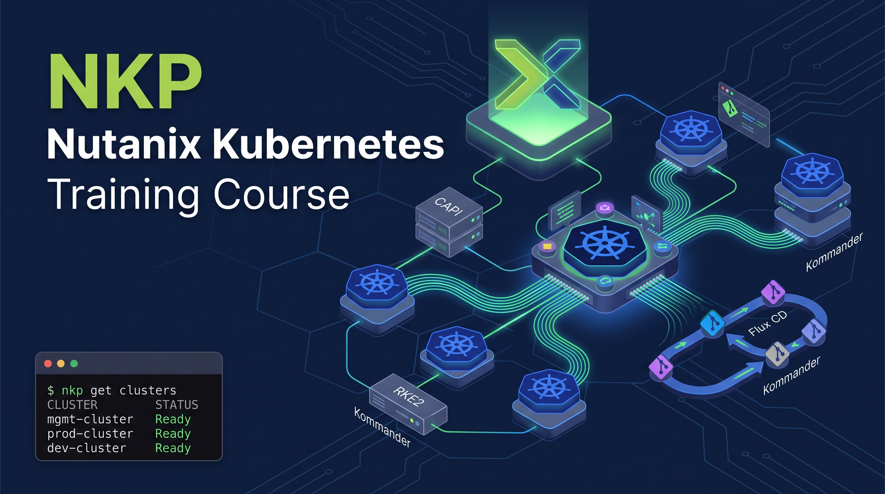

# NKP — Nutanix Kubernetes Platform Lab




> **Learn and teach NKP** — a hands-on, multi-VM lab course built on the
> [iximious Labs](https://labs.iximious.com) Flexbox platform.

---

## What is this course?

This course teaches you how to deploy, operate, and troubleshoot
**NKP (Nutanix Kubernetes Platform)** — Nutanix's enterprise Kubernetes fleet
management system — from first principles to production patterns.

NKP is not just one Kubernetes cluster. It is a **fleet management system**
built on top of Kubernetes itself, using Cluster API (CAPI), RKE2, Flux CD,
and Kommander to provision and govern multiple clusters at scale.

You will learn how to:

- Understand the NKP architecture — Bootstrap, Management, Workload, and Attached clusters
- Install and configure NKP on a real Nutanix AHV environment (Community Edition home lab)
- Simulate the full NKP lifecycle inside iximious Flexbox microVMs
- Work with the `nkp` CLI, `kubectl`, `helm`, `flux`, and `k9s`
- Deploy and manage add-ons: Cilium, MetalLB, Longhorn, Traefik, Prometheus, Grafana, Velero
- Operate GPU workloads on NKP (AHV passthrough / GPU Operator / MIG)

---

## Lab environment

The interactive labs run on **iximious Labs Flexbox** — up to 5 Firecracker
microVMs on a shared flat L2 network, no cloud account required.

| VM | Hostname | IP | Role | OS |
|---|---|---|---|---|
| vm1 | `bootstrap` | `172.16.0.10` | Operator workstation — `nkp` CLI, `kind`, `k9s` | Ubuntu 24.04 |
| vm2 | `controlplane` | `172.16.0.11` | RKE2 server (kube-apiserver, etcd, scheduler) | Rocky Linux 9.7 |
| vm3 | `worker-01` | `172.16.0.12` | RKE2 agent (kubelet, kube-proxy) | Rocky Linux 9.7 |
| vm4 | `worker-02` | `172.16.0.13` | RKE2 agent | Rocky Linux 9.7 |
| vm5 | `worker-03` | `172.16.0.14` | RKE2 agent | Rocky Linux 9.7 |

All VM rootfs images are pre-built OCI images hosted on GHCR:

```
ghcr.io/mercadoalex/nkp-bootstrap:latest
ghcr.io/mercadoalex/nkp-controlplane:latest
ghcr.io/mercadoalex/nkp-worker:latest
```

---

## Technical stack

| Component | Version | Notes |
|---|---|---|
| NKP | 2.17 | Renamed from D2iQ DKP |
| Kubernetes (RKE2) | 1.34.x | `v1.34.3+rke2r1` |
| Rocky Linux | 9.7 | Matches NKP 2.17 production node OS |
| Ubuntu | 24.04 | Bootstrap / operator workstation |
| CNI | Cilium | NKP default |
| Storage | Longhorn | NKP catalog add-on (replaces Nutanix CSI in lab) |
| Load Balancer | MetalLB L2 | Replaces Nutanix IPAM in lab |
| Ingress | Traefik | NKP default |
| Observability | Prometheus + Grafana | NKP catalog add-on |
| Backup / DR | Velero | NKP catalog add-on |
| GitOps | Flux CD 2.5 | NKP's built-in GitOps engine |

---

## Course structure

| Lesson | Title | Tier | VMs |
|---|---|---|---|
| [00](lessons/00-concepts/) | NKP Architecture — Core Concepts | Reading | — |
| [00b](lessons/00b-community-edition/) | Nutanix Community Edition — Home Lab Setup | Walkthrough | — |
| [01](lessons/01-os-image/) | Getting the NKP OS Image | Tier 1 | — |
| 02 | NKP Bootstrap Cluster | Tier 1 | 1 |
| 03 | Creating the Management Cluster | Tier 1 | 1 |
| 04 | NKP CLI Essentials | Tier 2 | 1 |
| 05 | kubectl on NKP | Tier 2 | 1 |
| 06 | Bootstrap → Pivot (full 5-VM lab) | Tier 3 | 5 |
| 07 | Node Operations | Tier 3 | 5 |
| 08 | Add-ons Catalog | Tier 3 | 5 |
| 09 | GitOps with Flux | Tier 3 | 5 |
| 10 | RBAC and Policy | Tier 3 | 5 |
| 11 | Monitoring and Observability | Tier 3 | 5 |
| 12 | Node Failure and Recovery | Tier 3 | 5 |
| [13](lessons/13-gpu/) | GPU on NKP | Tier 3 | 5 |
| [14](lessons/14-ansible/) | Node Operations with Ansible | Tier 3 | 5 |

---

## Real home lab (optional)

Lessons 00–03 also walk you through building a **real Nutanix home lab** using
Nutanix Community Edition (CE) on bare-metal hardware, then deploying NKP on top
of it. This is entirely optional — all hands-on exercises run in iximious Flexbox
without any physical hardware.

**Minimum hardware for CE:**
- Intel/AMD x86-64, 1 node
- 32 GB RAM, 200 GB SSD, 1 NIC

**Software stack:**
- Nutanix CE 2.1 (AOS 6.8.1 → LCM upgrade to AOS 7.3)
- Prism Central pc.7.3+
- NKP 2.17 on AHV

---

## Building the lab images

The VM rootfs images are built locally on macOS using Docker Buildx:

```bash
# Prerequisites: Docker Desktop running, logged in to GHCR
echo ghp_YOUR_PAT | docker login ghcr.io -u mercadoalex --password-stdin

# Pre-download RKE2 bundles (one-time, ~1.7 GB)
cd downloads/rke2
curl -fsSL https://get.rke2.io -o install.sh
# see downloads/rke2/README.md for full download commands

# Build and push all three images
cd rootfs && make all
```

See [`rootfs/README.md`](rootfs/README.md) for full build instructions.

---

## References

- [Nutanix Kubernetes Platform docs](https://portal.nutanix.com/page/documents/list?type=software&filterKey=software&filterVal=Nutanix%20Kubernetes%20Engine)
- [NKP Quickstart (nutanixdev)](https://github.com/nutanixdev/nkp-quickstart)
- [Nutanix Cloud Bible — NKP chapter](https://nutanixbible.com/18a-book-of-cloud-native-services-nutanix-kubernetes-platform.html)
- [Jonas Högman's NKP 5-part series](https://jonashogman.com/nkp-post-1-nutanix-kubernetes-platform-prerequisites)
- [iximious Labs](https://labs.iximious.com)

---

## Author

**Alejandro Mercado**  
Senior Cloud & Infrastructure Architect  
Published on [iximious Labs](https://labs.iximious.com)

---

<p align="center">
  Built with ❤️ by Alex for the Nutanix and Kubernetes community
</p>
