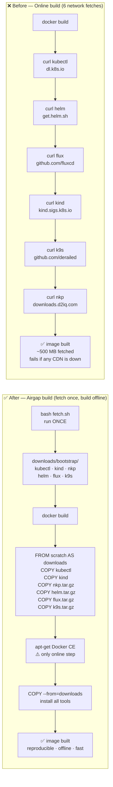

# downloads/bootstrap/

Pre-downloaded binaries for the `nkp-bootstrap` rootfs image build.

**These files are git-ignored** (large binaries). Run `fetch.sh` to populate this directory before building.

## Usage

```bash
# Step 1 — download all binaries (once)
cd downloads/bootstrap
bash fetch.sh

# Step 2 — build and push the image
cd ../../rootfs
bash bootstrap/build.sh
```

## Contents after fetch.sh

| File | Version | Source |
|---|---|---|
| `kubectl` | 1.34.3 | dl.k8s.io |
| `kind` | 0.27.0 | kind.sigs.k8s.io |
| `nkp_v2.17.1_linux_amd64.tar.gz` | 2.17.1 | downloads.d2iq.com |
| `helm-v3.17.3-linux-amd64.tar.gz` | 3.17.3 | get.helm.sh |
| `flux_2.5.1_linux_amd64.tar.gz` | 2.5.1 | github.com/fluxcd/flux2 |
| `k9s_Linux_amd64.tar.gz` | 0.32.5 | github.com/derailed/k9s |

## Build flow



